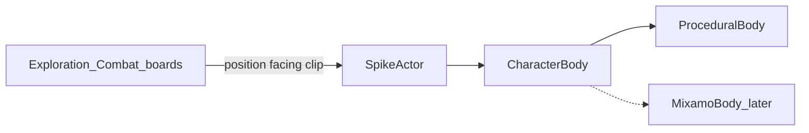

# STA 3D figures replace character sprites

Copied from the Cursor plan **STA 3D figure swap** (Ask-mode handoff). Work stays in this repo only.

## Overview

On `d:\STA` only: keep procedural 3D figures now behind a swappable `CharacterBody` API, expand to the full sprite clip set and combat, then default off character sprites. Mixamo is a later body implementation; merge to `ST-Adventures` is out of scope until STA is proven.

## Phases (checklist)

- [x] **A** — Extract `CharacterBody` + `ProceduralBody`; refactor `SpikeActor`
- [x] **B** — Full procedural clip set matching `characterSprites` names/timings
- [x] **C** — Add spike3d overlay to `PixiBattlefield` driven by `unitPose`
- [x] **D** — Male/female bodies, portrait-matched hair swaps, species/Klingon/department variants
- [x] **E** — Default 3D on; skip character sheet preload when 3D
- [x] **F** — Remove character sprite pipeline from STA; keep clip timing contract

## Decisions (locked)

- **Repo:** all work in this STA tree. No merge into `ST-Adventures` in this plan.
- **Now:** procedural body (`src/spike3d/HumanoidModel.js` + `src/spike3d/HumanoidAnimator.js`).
- **Later (after this plan):** Mixamo GLTF as a second `CharacterBody` implementation — same clip names, no board rewrite.
- **Keep:** environment / FX / dice sprites. Only **character** map sprites go away.
- **Pose contract:** game clip names from `src/data/adaptation/characterSprites.json` and combat `src/components/combat/unitPose.js` stay the API (`idle`, `walk`, `run`, `sneakIdle`, `sneakWalk`, fidgets, `phaser-attack01`, `melee`, `cover`, `punch`, `kick`, `dodge`, `getHit`, falls, `getUp`, `surrender`, `hazardPanic`).
- **Appearance:** male and female proportion presets; swappable procedural hair styles keyed to portrait id/variant so the board figure matches the portrait (Phase D).

## Architecture

- Boards emit poses (already partly done in `src/components/exploration/PixiExplorationBoard.jsx`); they must not import `HumanoidModel` / Mixamo loaders directly.
- `SpikeActor` (`src/spike3d/Spike3dScene.js`) owns pathing, yaw, contact shadow, ragdoll trigger; delegates draw/anim to `CharacterBody`.
- `CharacterBody`: `play(clip)`, `update(dt, travel)`, `root`, `setUniform(colour)`, `setAppearance({ gender, hairStyle, species, … })`, `dispose()`. Procedural wraps current model+animator. Mixamo later: `GLTFLoader` + `AnimationMixer` + name map (hair may stay procedural attachment or Mixamo morphs — follow-up).

## Phases

### A — Extract `CharacterBody` (no new clips)

- Introduce `src/spike3d/CharacterBody.js` (interface doc) + `ProceduralBody.js` wrapping existing model/animator.
- Refactor `SpikeActor` to use `ProceduralBody` only.
- Exit: exploration F1 3D still works; no board file imports procedural types.

### B — Full procedural clip tree on one body

Expand `src/spike3d/HumanoidAnimator.js` (and `applyPose` as needed) so every catalogue clip name plays with matching `loop` / `once` / `hold` and durations from `characterSprites.json`.

Order: sneak → fidgets → combat (`phaser-attack01`/`melee`/`cover`) → reactions → falls/`getUp` → `surrender`/`hazardPanic`.

Wire `SpikeActor.setPose` to prefer `pose.animation` when present (not only `gait`).

Exit: lead officer on Deck 10 can demonstrate each clip (dev trigger or lab) without sprites.

### C — Combat overlay

- Mirror exploration: Three overlay on `src/components/combat/PixiBattlefield.jsx`; `hideSprite` when spike3d on; feed poses from `shownPose` / unit tracks (`src/components/combat/pixi/unitView.js`).
- Blast ragdoll stays on existing Rapier path where already hooked; non-blast falls use procedural fall clips until Mixamo.

Exit: a Deck 10 fight plays strike, cover, reaction, fall, getUp in 3D with F1 fallback to sprites.

### D — Variants (party + enemies): gender, hair, species

Portraits already encode **species + gender + variant** (e.g. `human-male-1`, `human-female-2` in `src/data/adaptation/portraits.json`). Map figures must follow that, not one unisex capsule.

- **Male / female bodies:** shared skeleton with gender proportion presets (shoulders, hips, chest, height scale) on `ProceduralBody` — not separate anim trees.
- **Hair styles that swap to match portraits:**
  - Build a small procedural hair catalogue (several male cuts, several female styles; species-aware where needed — e.g. Andorian antennae stay species cues, not hair).
  - Data map `portraitId` (or `species|gender|variant`) → `hairStyleId` + hair colour in something like `src/data/adaptation/spike3dAppearance.json` (or under `spike3d/`).
  - `HumanoidModel` replaces head hair meshes via `setHair(styleId)` (clear old hair group, attach style) so changing portrait updates the board figure.
  - First pass: enough styles to cover the portrait variants used on Deck 10 / party; expand catalogue as portraits need it.
- **Also:** species cues (ears/ridge/fur/antennae), Klingon armour (no shirt recolour), department uniform colour.
- Resolve appearance from the character’s portrait the same way sprites use `getSpriteSet`, but output a 3D appearance config (gender, hairStyle, species, uniform), not a PNG path.

Exit: male and female party members (and enemies) show distinct bodies; hair on the board matches the chosen portrait’s look closely enough to read as the same person.

### E — Default 3D; sprites fallback only

- Default `src/spike3d/enabled.js` preference to 3D on; F1 keeps sprites for debug.
- Stop preloading character sheets when 3D is on (perf win in `figures.js` / MapFadeIn path).

Exit: normal play never shows character sprites unless F1.

### F — Remove character sprite pipeline (STA)

- Delete / stop shipping character PNGs under `public/art/sprites/characters/`, character parts of Sprites editor, `makeCharacterSprites.mjs` character generation, SheetStore character load when 3D-only.
- Leave `characterSprites.json` **clip name + timing** table (or move timings to `spike3d/clips.json`) so Mixamo mapping still has a contract.
- Note in `docs/design-tracker.md` / `docs/sprites.md`: map figures are 3D; environment sprites unchanged.

Exit: no character sheet load on exploration/combat critical path.

### Out of scope (this plan)

- Mixamo asset download / `MixamoBody` implementation (follow-up when GLTFs exist).
- Merge or replace `d:\ST-Adventures`.
- Unreal, production Starfleet art, rewriting rules.

## First implementation slice (after plan approval)

Phase **A** only: extract `ProceduralBody`, refactor `SpikeActor`, confirm Deck 10 exploration unchanged.
